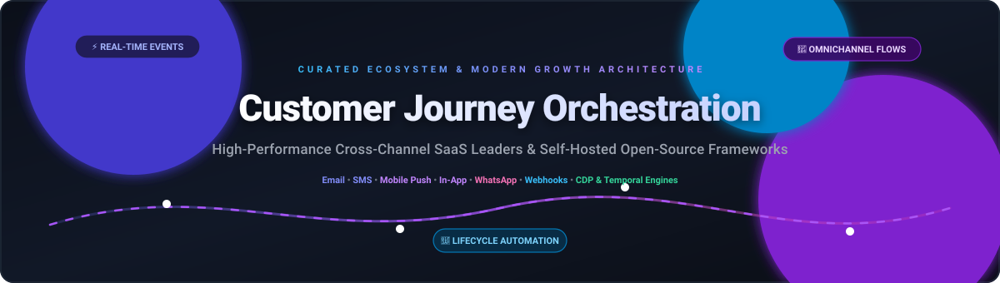

<p align="center">
  
</p>

# 🚀 Awesome Customer Journey Orchestration (CJO)

<p align="center">
  <a href="https://github.com/ishandutta2007/Awesome-Awesome-Awesome"></a><a href="https://discord.gg/jc4xtF58Ve"></a>
  <a href="https://github.com/ishandutta2007/Awesome-Awesome-Awesome"></a>
  <a href="https://creativecommons.org/publicdomain/zero/1.0/"></a>
  <a href="#-how-to-contribute"></a>
  <a href="https://github.com/ishandutta2007"></a>
</p>

> 🧭 A comprehensive, community-curated collection of top **Customer Journey Orchestration (CJO)** SaaS platforms, open-source workflow engines, customer engagement systems, and lifecycle marketing frameworks.

---

## 📖 Table of Contents

- [💡 What is Customer Journey Orchestration?](#-what-is-customer-journey-orchestration)
- [📊 Sector Overview & Market Dynamics](#-sector-overview--market-dynamics)
- [🏢 SaaS / Hosted Platforms](#-saas--hosted-platforms)
- [💻 Open-Source Platforms & Self-Hosted Alternatives](#-open-source-platforms--self-hosted-alternatives)
- [🛠️ Complementary Open-Source Infrastructure & CDP Tools](#️-complementary-open-source-infrastructure--cdp-tools)
- [🏗️ Architecting an Open-Source Journey Stack](#️-architecting-an-open-source-journey-stack)
- [🤝 How to Contribute](#-how-to-contribute)
- [☕ Support](#-support)
- [📈 Star History](#-star-history)
- [📜 Disclaimer](#-disclaimer)

---

## 💡 What is Customer Journey Orchestration?

**Customer Journey Orchestration (CJO)** is the dynamic discipline of sensing real-time behavioral signals, evaluating lifecycle state, and triggering multi-step, personalized interactions across every digital touchpoint (Email ✉️, SMS 📱, Mobile Push 🔔, In-App 💬, WhatsApp 🟢, Webhooks 🔗).

Unlike static drip marketing, orchestration engines dynamically branch, hold, re-evaluate, and personalize user paths based on live data from Customer Data Platforms (CDPs), event buses, and AI decisioning models.

---

## 📊 Sector Overview & Market Dynamics

The global Customer Journey Orchestration market is valued at approximately **$12.5B–$13.1B in 2025** and is projected to reach **~$14.8B by 2026**, expanding at an aggressive CAGR of 13%–18%. 

The market dynamics exhibit a **moderately concentrated, two-tier landscape**: enterprise mega-caps (Salesforce, Adobe) dominate comprehensive core cloud suites, while specialized, high-growth contenders (Braze, Iterable, Customer.io) capture aggressive product-led and mobile-first market share alongside emerging privacy-first, developer-centric open-source engines.

---

## 🏢 SaaS / Hosted Platforms

Below is the comparison of premier Customer Journey Orchestration and multi-channel lifecycle platforms, **sorted by company valuation / scale (descending)**:

| Platform | Company Valuation / Annual Scale | Starting Tier Price | Free Tier / Trial Limit | Key Focus & Strengths |
| :--- | :--- | :--- | :--- | :--- |
| **[Salesforce Journey Builder](https://www.salesforce.com/)** | **~$186B–$220B Market Cap** ($41.5B FY26 Rev) | **$1,250/month** (billed annually, Account Engagement Growth) | **30-Day Free Trial** with pre-configured sandbox data | Enterprise Marketing Cloud journey designer with Einstein AI optimization, real-time CDP synchronisation, and predictive routing. |
| **[Adobe Campaign](https://business.adobe.com/products/campaign.html)** | **~$94B Market Cap** ($21.5B+ Annual Rev) | **$1,800/month** (base entry deployment) | **No Free Tier** (14–30 day guided enterprise proof-of-concept upon sales approval) | Omnichannel campaign orchestration across batch and real-time triggers. *(Note: Adobe Campaign Classic sunsets March 2027)*. |
| **[Braze](https://www.braze.com/)** | **~$3.2B Market Cap** (~$800M Annual ARR) | **$5,000/month** (~$60,000/year base growth commitment) | **No Free Tier** (Custom guided POC / sandbox via sales evaluation) | Mobile-first and cross-channel engagement leader with Canvas workflow builder, predictive AI, and real-time event streaming. |
| **[Bloomreach Engagement](https://www.bloomreach.com/)** | **~$2.2B Valuation** (Series F) | **$1,500/month** (Entry scale package) | **14-Day Free Trial** (Guided sandbox environment upon evaluation request) | Unified e-commerce data platform, predictive search, web personalization, and automated multi-channel lifecycle paths. |
| **[Iterable](https://iterable.com/)** | **~$2.0B Valuation** (~$240M ARR) | **$500/month** (Growth starter tier for early teams) | **No Free Tier** (Custom sales demo & guided POC access only) | Visual cross-channel workflow orchestration, high-throughput APIs, advanced experimentation, and AI journey path optimization. |
| **[Insider](https://insiderone.com/)** | **~$2.0B Valuation** (Series E) | **$1,200/month** (Base omnichannel package) | **14-Day Free Trial** with sample e-commerce demo dataset | Omnichannel customer experience platform connecting predictive segments with WhatsApp, SMS, Web push, and mobile apps. |
| **[MoEngage](https://www.moengage.com/)** | **~$850M–$900M Valuation** (~$100M ARR) | **$999/month** (Standard growth tier) | **Free Forever Tier**: Up to 10,000 Monthly Active Users (Push channel only) | Insight-led customer engagement platform with Merlin AI assist, automated path journeys, and mobile-first behavioral analysis. |
| **[CleverTap](https://clevertap.com/)** | **~$775M Valuation** (Series D) | **$75/month** (Essentials plan for up to 5,000 MAU) | **30-Day Free Trial** with full access up to 10,000 MAU | Retention automation engine, behavioral cohorts, automated lifecycle funnels, and real-time mobile push orchestration. |
| **[Customer.io](https://customer.io/)** | **~$750M Valuation** (~$100M ARR) | **$100/month** (Essentials plan, up to 5,000 profiles) | **14-Day Free Trial** with full feature access and up to 1,000 test emails | Flexible event-driven behavioral messaging platform for product-led growth (PLG) teams with visual workflow canvases. |
| **[Acoustic Journey Analytics](https://acoustic.com/)** | **~$500M+ Scale** (PE-backed Centerbridge) | **$1,000/month** (Base interaction tier) | **14-Day Free Trial** on select Acoustic Connect modules | Customer journey analytics and path exploration to uncover user friction points and trigger multi-channel re-engagement. |

---

## 💻 Open-Source Platforms & Self-Hosted Alternatives

Open-source customer journey orchestration tools, visual canvas builders, and privacy-preserving marketing engines, **sorted by GitHub Stars (descending)**:

| Project | Stars | License | Highlights & Architecture |
| :--- | :---: | :--- | :--- |
| **[n8n](https://github.com/n8n-io/n8n)** | [](https://github.com/n8n-io/n8n/stargazers) | Fair-code (Sustainable Use) | Node.js/TypeScript. Fair-code visual workflow automation engine extensively used to stitch event webhooks, CDPs, and omnichannel journeys. |
| **[PostHog](https://github.com/posthog/posthog)** | [](https://github.com/posthog/posthog/stargazers) | MIT / PostHog Array | Python, ClickHouse, React. All-in-one developer platform featuring session replay, behavioral funnels, feature flags, user paths, and event triggers. |
| **[Novu](https://github.com/novuhq/novu)** | [](https://github.com/novuhq/novu/stargazers) | MIT | TypeScript, NestJS, Redis. Open-source notification infrastructure and workflow management for cross-channel routing (In-App, Push, Email, SMS, Chat). |
| **[Chatwoot](https://github.com/chatwoot/chatwoot)** | [](https://github.com/chatwoot/chatwoot/stargazers) | MIT | Ruby on Rails, Vue.js. Omnichannel engagement and live-conversation platform with automated campaign journeys and multi-inbox routing. |
| **[Mautic](https://github.com/mautic/mautic)** | [](https://github.com/mautic/mautic/stargazers) | GPL-3.0 | PHP, MySQL. Community-owned marketing automation with multi-channel campaigns, lead scoring, email drip automation, and full GDPR compliance. |
| **[Dittofeed](https://github.com/dittofeed/dittofeed)** | [](https://github.com/dittofeed/dittofeed/stargazers) | MIT | TypeScript, ClickHouse, Temporal. Developer-first engagement platform with drag-and-drop journey builder, git-based workflows, and testing SDKs. |
| **[Laudspeaker](https://github.com/laudspeaker/laudspeaker)** | [](https://github.com/laudspeaker/laudspeaker/stargazers) | AGPL-3.0 | Node.js, PostgreSQL. Visual no-code journey builder and Braze alternative. Event-triggered sequences across email, SMS, and Firebase push. |
| **[Corteza](https://github.com/cortezaproject/corteza)** | [](https://github.com/cortezaproject/corteza/stargazers) | Apache-2.0 | Go, Vue.js. Low-code platform with BPMN 2.0 workflow orchestration, CRM records, granular access control, and REST automation. |
| **[LimeJourney](https://github.com/limejourney/limejourney)** | [](https://github.com/limejourney/limejourney/stargazers) | Source-available | TypeScript, Next.js, Kafka, Temporal, ClickHouse. AI-driven journey designer with dynamic segment evaluation and BYOI integration model. |
| **[Helio](https://github.com/achref-soua/helio)** | [](https://github.com/achref-soua/helio/stargazers) | AGPL-3.0 | Rust/TypeScript, Temporal. AI-native growth platform unifying CDP, natural-language segments, MCP server, and cross-channel journeys. |

---

## 🛠️ Complementary Open-Source Infrastructure & CDP Tools

Supporting open-source building blocks for customer data collection, privacy-preserving event routing, and real-time segmentation, **sorted by GitHub Stars (descending)**:

| Tool | Stars | License | Purpose & Role |
| :--- | :---: | :--- | :--- |
| **[Plausible Analytics](https://github.com/plausible/analytics)** | [](https://github.com/plausible/analytics/stargazers) | AGPL-3.0 | Lightweight, cookie-free, privacy-first web traffic & conversion goal tracking. |
| **[Formbricks](https://github.com/formbricks/formbricks)** | [](https://github.com/formbricks/formbricks/stargazers) | AGPL-3.0 | In-app user feedback and survey engine used to trigger real-time journey follow-ups. |
| **[Jitsu](https://github.com/jitsucom/jitsu)** | [](https://github.com/jitsucom/jitsu/stargazers) | MIT | Resilient real-time event ingestion engine; open-source Segment alternative. |
| **[RudderStack](https://github.com/rudderlabs/rudder-server)** | [](https://github.com/rudderlabs/rudder-server/stargazers) | AGPL-3.0 | Enterprise-grade event pipeline and customer data routing infrastructure. |
| **[Metarank](https://github.com/metarank/metarank)** | [](https://github.com/metarank/metarank/stargazers) | Apache-2.0 | Real-time personalization and ranking engine for personalized journey recommendations. |
| **[Apache Unomi](https://github.com/apache/unomi)** | [](https://github.com/apache/unomi/stargazers) | Apache-2.0 | OASIS Context Server specification reference CDP for unified customer profiles. |
| **[Fusion](https://github.com/fusion-hq/fusion)** | [](https://github.com/fusion-hq/fusion/stargazers) | MIT | User analytics, live-chat interactions, and mobile push notification delivery. |
| **[OpenClix](https://github.com/OpenClix/openclix)** | [](https://github.com/OpenClix/openclix/stargazers) | MIT | Mobile application retention, user engagement automation, and conversion funnels. |

---

## 🏗️ Architecting an Open-Source Journey Stack

Build a completely self-hosted, vendor-independent customer journey automation engine with this reference design:

```
┌─────────────────────────────────────────────────────────────┐
│              User Interaction & Touchpoints                 │
│         (Web Applications • Mobile iOS/Android • POS)       │
└──────────────────────────────┬──────────────────────────────┘
                               │ Real-time Events
                               ▼
┌─────────────────────────────────────────────────────────────┐
│            Ingestion & Customer Data Platform               │
│               [ RudderStack / Jitsu / PostHog ]             │
└──────────────────────────────┬──────────────────────────────┘
                               │ Normalized Events & Identity
                               ▼
┌─────────────────────────────────────────────────────────────┐
│                 Storage & Analytics Engine                  │
│               [ PostgreSQL + ClickHouse / Redis ]           │
└──────────────────────────────┬──────────────────────────────┘
                               │ State Triggers & Cohorts
                               ▼
┌─────────────────────────────────────────────────────────────┐
│          Journey Orchestration & Decisioning Logic          │
│       [ Dittofeed / Laudspeaker / Mautic / Helio / n8n ]    │
└──────────────────────────────┬──────────────────────────────┘
                               │ Dispatches Actions
                               ▼
┌─────────────────────────────────────────────────────────────┐
│                    Omnichannel Dispatch                     │
│    ✉️ Email (SES / Resend)      🔔 Push (Novu / FCM / APNs)  │
│    📱 SMS (Twilio / Bird)       🟢 WhatsApp (Meta Graph API)│
└─────────────────────────────────────────────────────────────┘
```

---

## 🤝 How to Contribute

Contributions make the open-source community thrive! 🌟

1. 🍴 **Fork the Project**
2. 🌿 **Create your Feature Branch** (`git checkout -b feature/NewPlatformEntry`)
3. 📝 **Add Your Entry**: Ensure descriptions are factual, pricing details are included for SaaS tools, and repositories link to authoritative sources.
4. 💾 **Commit your Changes** (`git commit -m 'feat: add NewPlatformEntry to SaaS list'`)
5. 🚀 **Push to the Branch** (`git push origin feature/NewPlatformEntry`)
6. 📬 **Open a Pull Request**

---

## ☕ Support

Thank you for exploring and building with this community resource! 💖

If this repository helped you discover tools or design your journey stack, please consider:
- ⭐ **Starring** the repository on GitHub
- 🍴 **Forking** and sharing with your growth & engineering teams
- ☕ Supporting continued maintenance on the [GitHub Sponsors Dashboard](https://github.com/sponsors/ishandutta2007)

---

## 📈 Star History

[](https://star-history.dera.page/#ishandutta2007/Awesome-Customer-Journey-Orchestration&type=date&legend=top-left)

---

## 📜 Disclaimer

This project is an independently maintained, community-curated educational index. Product names, logos, and brands are property of their respective trademark holders. Organizations deploying customer journey systems are responsible for complying with applicable privacy legislation (such as GDPR, CCPA, and CAN-SPAM).
